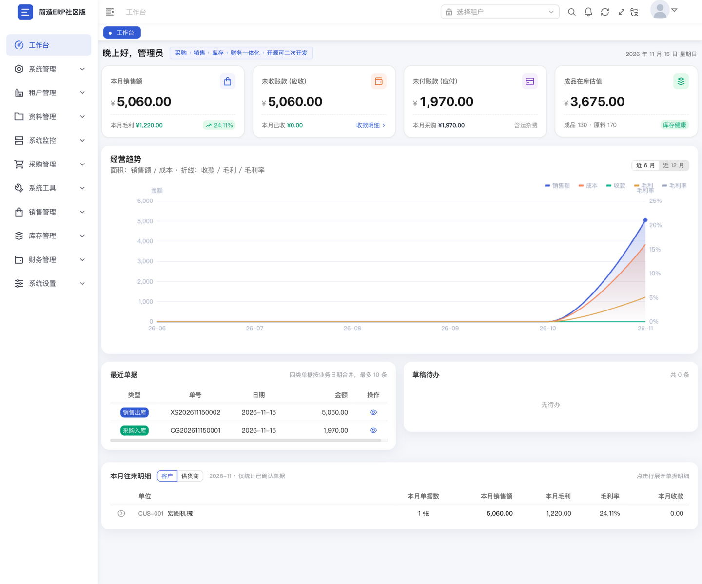
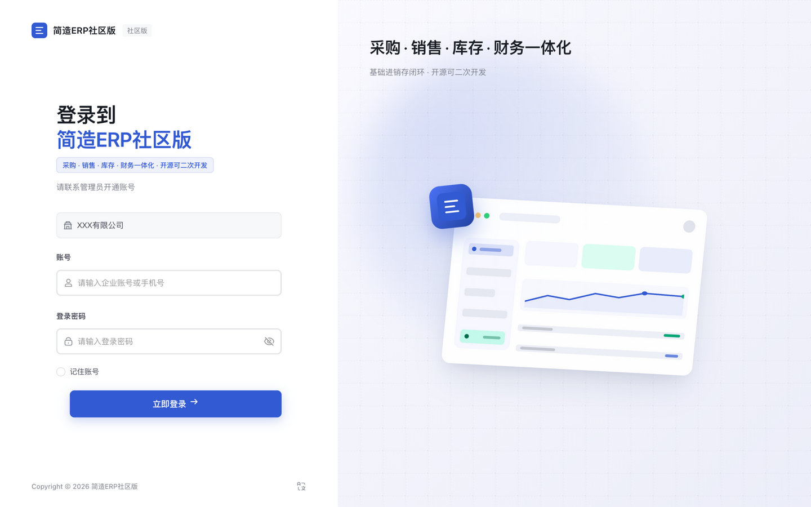
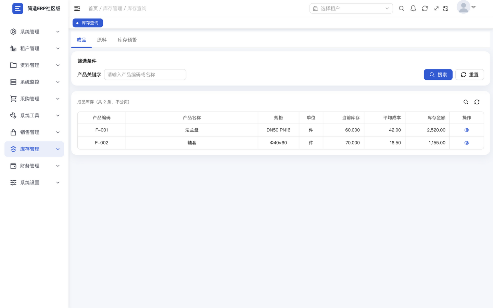
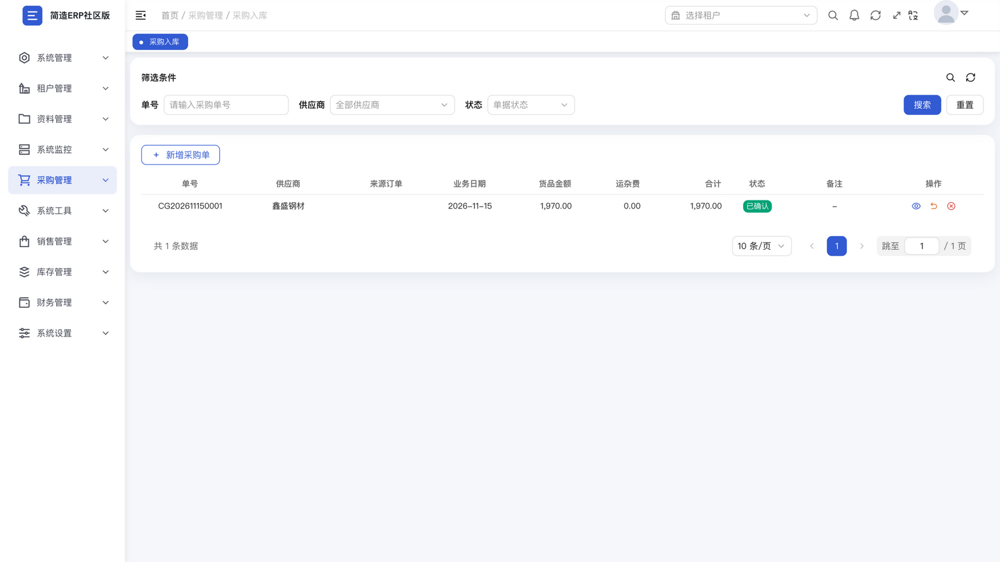
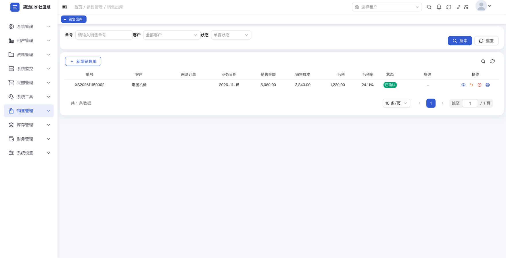
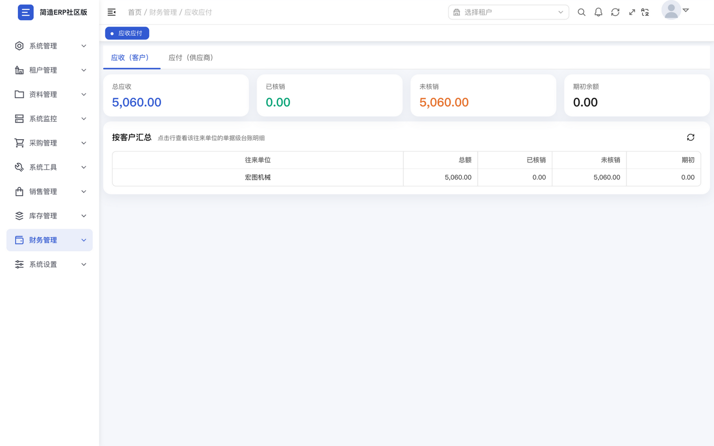

# 简造ERP社区版

> 一套现代栈、可直接 fork 二次开发的基础进销存骨架。
>
> **简造ERP社区版**是简造 ERP 的开源社区发行版，专注基础资料与 PC 端进销存操作功能。

---

## 界面预览





| 库存查询 | 采购入库 |
|---|---|
|  |  |

| 销售出库（含成本快照与毛利） | 应收应付 |
|---|---|
|  |  |

> 截图取自本仓库默认种子数据 + 一笔示例采购/销售单，不含任何真实客户信息。

## 这是什么

面向小 micro 企业 / 个体商贸场景的轻量进销存，覆盖「采购 → 销售 → 库存 → 收付 → 对账」完整闭环。代码可读、结构清晰、一键启动，适合作为二次开发的起点。

**技术栈**

| 层 | 选型 |
|---|---|
| 后端 | Java 17 · Spring Boot 3.5 · MyBatis-Plus · Sa-Token · MySQL 8 · Redis 7 |
| 底座 | RuoYi-Vue-Plus 5.X（MIT，已裁剪并重命名） |
| 前端 | Vue 3.5 · Vite 7 · TypeScript · Pinia · UnoCSS · **TDesign Vue Next 1.20** |
| 部署 | Docker Compose（MySQL + Redis + App + Nginx） |

## 为什么值得看

- **全量 TDesign 前端**：2,800+ 处 TDesign 组件标签、75 个视图（其中 23 个 ERP 业务页），Element Plus 依赖与模板标签已彻底移除；配套自研 token 体系、亮/暗双主题、`TDesignResolver` 组件自动导入、`.erp-*` 语义 class 库。RuoYi 系项目大多仍停在 Element Plus —— 这是一套可直接复用的现代化迁移实践，见 [docs/ui-migration.md](docs/ui-migration.md)。
- **现代栈骨架**：Spring Boot 3.5 / Java 17 / Vue 3 / Vite 7，不是老一代 jQuery 或 Vue 2 底座。
- **完整闭环而非演示**：工作台看板、基础资料、采购/销售与退货、其他出入库、库存流水与期初、应收应付与收付款核销、结算账户、综合成本、月度对账单、单据打印、采购/销售订单分批执行 —— 都能跑通。
- **干净的可读历史**：按里程碑重建的提交演进（见 [docs/history.md](docs/history.md)）。

> 诚实限定：组件层已全量 TDesign 化，但视觉 token 仍沿用 `--el-*` 命名作为自有兼容层（自 Element Plus `base.css` 的 `:root` 值演化而来），设计系统是「TDesign 组件 + 自研 token / 暗色体系」的混合体，不是纯 TDesign 设计系统。

## 功能范围

| 模块 | 内容 |
|---|---|
| 工作台 | 本月销售/毛利/应收/应付/库存估值、经营趋势、最近单据、草稿待办、库存预警、本月往来明细 |
| 基础资料 | 商品（分类、配比、成本单价、含税、Excel 导入导出）、供应商、客户、仓库 |
| 采购 | 采购入库（运杂费分摊、不含税成本、移动加权）、采购退货 |
| 销售 | 销售出库（一单一价、成本快照、毛利）、销售退货 |
| 库存 | 其他入/出库、库存快照与流水、库存期初、条件更新防超卖、库存查询 |
| 财务 | 应收应付台账、往来期初、收/付款单与按单核销、其他收支、结算账户、综合成本报表 |
| 对账与打印 | 月度对账单、内置送货单/对账单渲染、自定义打印模板 |
| 订单 | 采购/销售订单分批执行、未交量、变更留痕 |
| 系统 | 登录、角色、菜单、按钮级权限、运行日志 |

**社区版不含**：生产/委外加工、库存盘点、数据备份、订单层 M2、微信小程序、SaaS 多企业账户与试用套餐。这些属于简造 ERP 商业版，见 [COMMERCIAL.md](COMMERCIAL.md)。

## 快速开始

环境要求：JDK 17（运行可用 JRE 21）、Node 20+、pnpm、Maven 3.9+、Docker。

### 方式 A：Docker Compose（完整部署）

Compose 只消费构建产物，需先生成 JAR 与静态文件：

```bash
git clone https://github.com/Fawkes-hub/jianzao-erp-community.git
cd jianzao-erp-community

# 1) 后端 JAR → deploy/app/erp.jar
cd jianzao-backend && mvn clean install -DskipTests && cd ..
cd erp-modules  && mvn clean install -DskipTests && cd ..
cd jianzao-backend/jianzao-admin && mvn -Pprod package -DskipTests && cd ../..
mkdir -p deploy/app && cp jianzao-backend/jianzao-admin/target/jianzao-admin.jar deploy/app/erp.jar

# 2) 前端静态文件 → deploy/frontend-dist/
cd jianzao-erp && pnpm install --frozen-lockfile && pnpm build:prod && cd ..
rm -rf deploy/frontend-dist && cp -r jianzao-erp/dist deploy/frontend-dist

# 3) 起 MySQL + Redis + App + Nginx
cd deploy && cp .env.example .env
vi .env          # 改 4 个必填项：MYSQL_ROOT_PASSWORD / MYSQL_PASSWORD / REDIS_PASSWORD / JWT_SECRET
docker compose up -d
```

访问 `http://localhost`，账号 `admin` / `admin123`（登录后立即改密）。详细说明见 [deploy/README.md](deploy/README.md)。

### 方式 B：本地开发

只起 MySQL + Redis（首次启动会自动执行 `deploy/mysql/init/` 下的 SQL），后端跑 `dev` profile，前端走 Vite：

```bash
cd deploy && cp .env.example .env
# .env 改成与 application-dev.yml 一致：MYSQL_ROOT_PASSWORD=localroot123、REDIS_PASSWORD=ruoyi123
# 并在 docker-compose.yml 中取消 redis 的 ports 注释
docker compose up -d mysql redis
cd ..

# 后端（8080）
cd jianzao-backend && mvn clean install -DskipTests && cd ..
cd erp-modules  && mvn clean install -DskipTests && cd ..
cd jianzao-backend/jianzao-admin && mvn spring-boot:run

# 前端（另开终端，5173）
cd jianzao-erp && pnpm install --frozen-lockfile && pnpm dev
```

访问 `http://localhost:5173`。前端环境变量已内置在 `.env.development` / `.env.production`，个人覆盖写进 `*.local`（已 gitignore）。

## 已知限制

- **滑块验证码默认关闭**：登录页的滑块组件依赖第三方 tac SDK，该 SDK 授权不明，未随仓库分发；后端 `captcha.enable` 默认 `false`，登录接口仍有 20 次/分钟/IP 的限流兜底。需要验证码时请自备已授权 SDK 放入 `jianzao-erp/public/tac/` 再把 `captcha.enable` 设为 `true`。
- **接口加密默认关闭**：传输安全依赖 HTTPS。开启方式见 `jianzao-backend/.../application.yml` 中 `api-decrypt` 的注释。

## 安全

漏洞请通过 GitHub Security Advisory 私下报告，不要开公开 issue。部署前的必做项见 [SECURITY.md](SECURITY.md)。

## 许可证与品牌

| 项 | 说明 |
|---|---|
| 自研代码 | **AGPL-3.0**，见 [LICENSE](LICENSE) |
| 商业授权 | 需闭源集成、OEM 或不公开网络端改动 → 见 [COMMERCIAL.md](COMMERCIAL.md) |
| 第三方组件 | MIT，见 [THIRD_PARTY_NOTICES.md](THIRD_PARTY_NOTICES.md) |
| 名称与 logo | **不在开源授权范围内**，见 [TRADEMARK.md](TRADEMARK.md) |
| 贡献 | 欢迎 PR，需先签 CLA，见 [CONTRIBUTING.md](CONTRIBUTING.md) |

核心代码由项目发起人维护，社区贡献在 CLA 框架下接受。

## 目录结构

```
jianzao-erp-community/
├── jianzao-backend/     # 后端底座（RuoYi-Vue-Plus 裁剪，MIT 原文保留）
├── erp-modules/         # 自研 ERP 业务模块（AGPL-3.0）
├── jianzao-erp/         # 前端（TDesign）
├── deploy/              # Docker Compose / Nginx / 初始化 SQL
├── docs/                # 公开技术文档
├── LICENSE              # AGPL-3.0 全文
├── SECURITY.md
├── THIRD_PARTY_NOTICES.md
├── TRADEMARK.md
├── COMMERCIAL.md
├── CONTRIBUTING.md
├── CLA.md / CCLA.md
└── README.md
```

---

© 2026 简造ERP社区版项目发起人。本仓库名称与标识的使用受 [TRADEMARK.md](TRADEMARK.md) 约束。
